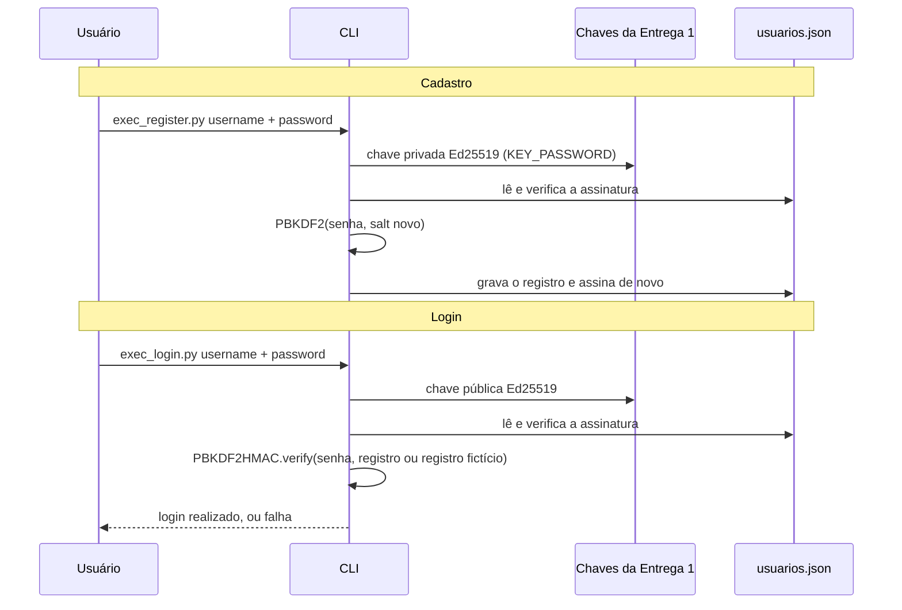

# Entrega 2: Hash e autenticação segura

Os comandos devem ser executados a partir da raiz do repositório.

## Problema e objetivo

Situação-problema: uma aplicação necessita cadastrar usuários sem armazenar senhas em texto puro.

Requisitos mínimos: criar cadastro e login com Argon2id, scrypt, bcrypt ou PBKDF2 com configuração apropriada; armazenar hash e salt quando aplicável; testar login correto e incorreto; explicar por que SHA-256 isolado não é adequado para senhas; demonstrar comparação segura pela biblioteca.

Produto: aplicação, testes, evidência de registro protegido e documentação do fluxo.

A solução é uma aplicação de linha de comando que reaproveita a Entrega 1. As senhas são protegidas com PBKDF2, e o arquivo de usuários é assinado com a chave Ed25519 da Entrega 1. Assim, quem altera o arquivo sem ter a chave privada é detectado.

## Ambiente e tecnologias

| Item | Versão ou uso |
| --- | --- |
| Sistema usado nos testes | Windows 11 |
| Python | 3.13.18 |
| [cryptography](https://cryptography.io/) | 50.0.2, PBKDF2 e assinatura Ed25519 |
| pytest | 9.2.0, testes automatizados |
| [uv](https://docs.astral.sh/uv/) | Instalação do Python e das dependências, com versões fixadas em `uv.lock` |

## Algoritmos, parâmetros e justificativa

| Finalidade | Algoritmo | Parâmetros | Justificativa |
| --- | --- | --- | --- |
| Hash de senha | PBKDF2 com HMAC-SHA256 | 600.000 iterações, salt de 16 bytes, saída de 32 bytes | A OWASP recomenda pelo menos 600.000 iterações para PBKDF2-HMAC-SHA256. A implementação é da mesma biblioteca usada na Entrega 1 (`cryptography`) |
| Salt | `os.urandom` | 16 bytes, novo a cada cadastro | Senhas iguais geram hashes diferentes, o que invalida tabelas pré-calculadas |
| Integridade do arquivo de usuários | Ed25519, da Entrega 1 | Chave privada cifrada com `KEY_PASSWORD` | Impede que alguém troque o hash de um usuário pelo hash de uma senha que conhece |
| Política de senha | Tamanho | De 15 a 64 caracteres, sem regras de composição | O mínimo vem da NIST SP 800-63B-4 para senha usada como fator único |

### Formato do registro

Cada usuário guarda o algoritmo, as iterações, o salt e o hash. O arquivo inteiro tem uma assinatura:

```json
{
  "users": {
    "alice": {
      "algorithm": "pbkdf2-sha256",
      "iterations": 600000,
      "salt": "<16 bytes em base64>",
      "hash": "<32 bytes em base64>"
    }
  },
  "signature": "<assinatura Ed25519 em base64>"
}
```

Como as iterações ficam no registro, o valor pode aumentar no futuro sem invalidar os cadastros antigos.

### Por que SHA-256 isolado não é adequado para senhas

O SHA-256 serve para verificar integridade, mas foi projetado para ser rápido. Isso favorece quem tenta adivinhar senhas depois de um vazamento. Resultado do [benchmark_hash.py](benchmark_hash.py) nesta máquina:

| Algoritmo | Hashes por segundo |
| --- | --- |
| SHA-256 | 1.363.616 |
| PBKDF2-SHA256, 600.000 iterações | 11,5 |

Há ainda dois problemas:

- **Sem salt:** a mesma senha sempre gera o mesmo SHA-256. Isso revela contas com senhas iguais e permite usar tabelas pré-calculadas.
- **Sem custo configurável:** o SHA-256 não fica mais lento conforme o hardware evolui. No PBKDF2, basta aumentar as iterações.

### Comparação segura

O código não compara hashes com `==`. A função `verify_password` chama `PBKDF2HMAC.verify` da biblioteca `cryptography`. A biblioteca deriva o hash de novo e o compara em tempo constante, então o tempo da comparação não depende da posição do primeiro byte diferente. Se os valores forem diferentes, ela lança `InvalidKey`.

Quando o usuário não existe, o login roda o PBKDF2 contra um registro fictício e mostra a mesma mensagem de senha errada. Assim, nem a mensagem nem o tempo revelam quais usuários existem.

## Implementação e execução

| Arquivo | Função |
| --- | --- |
| [password_hash.py](password_hash.py) | Funções `hash_password` e `verify_password` |
| [user_store.py](user_store.py) | Salva, lê, assina e verifica o arquivo de usuários |
| [entrega1.py](entrega1.py) | Importa as chaves e a assinatura da Entrega 1 |
| [exec_register.py](exec_register.py) | Cadastra um usuário |
| [exec_login.py](exec_login.py) | Verifica o login |
| [exec_tamper.py](exec_tamper.py) | Simula um atacante que troca o hash de um usuário |
| [benchmark_hash.py](benchmark_hash.py) | Compara SHA-256 e PBKDF2 |
| [test_password_hash.py](test_password_hash.py) e [test_exec_auth.py](test_exec_auth.py) | Testes automatizados |

### Fluxo



O login usa apenas a chave pública. Por isso, quem só verifica senhas não consegue alterar o cadastro.

### Preparação

Instale as dependências:

```bash
uv sync
```

Defina a senha das chaves privadas da Entrega 1, com no mínimo 8 caracteres. Ela é necessária apenas para cadastrar:

```powershell
$env:KEY_PASSWORD = Read-Host "Senha das chaves" -MaskInput
```

### Execução

As senhas dos usuários são digitadas sem aparecer na tela e não ficam no histórico do terminal. O cadastro gera as chaves em `entrega-1/keys/` se ainda não existirem.

Cadastrar um usuário:

```bash
uv run python entrega-2/exec_register.py username
```

```text
Senha:
Confirme a senha:
Usuário alice cadastrado em entrega-2\data\usuarios.json
```

Login correto e incorreto:

```bash
uv run python entrega-2/exec_login.py username
```

```text
Senha:
Login realizado: username
```

```text
Senha:
Falha: usuário ou senha incorretos.
```

Ver o registro protegido:

```bash
cat entrega-2/data/usuarios.json
```

Simular um atacante que troca o hash de `username` pelo de uma senha que ele conhece:

```bash
uv run python entrega-2/exec_tamper.py username
```

Depois disso, nem a senha do atacante nem a original são aceitas:

```text
Falha: o arquivo de usuários foi alterado fora da aplicação.
```

Comparar SHA-256 e PBKDF2:

```bash
uv run python entrega-2/benchmark_hash.py
```

| Script | Parâmetro | Função |
| --- | --- | --- |
| Todos | `usuario` | De 3 a 32 caracteres: letras, números, `.`, `_` ou `-`. Maiúsculas viram minúsculas |
| Todos | `--file caminho` | Usa outro arquivo de usuários |
| `exec_tamper.py` | `--password senha` | Senha que o atacante coloca no registro |

As falhas terminam o script com código de saída 1.

## Testes e evidências

Execute os testes automatizados, que usam chaves e arquivos temporários:

```bash
uv run pytest entrega-1 entrega-2
```

Os testes cobrem:

- parâmetros do PBKDF2, salt novo a cada hash e senha ausente do registro;
- login correto, senha incorreta e usuário inexistente, com a mesma mensagem nos dois erros;
- execução do PBKDF2 mesmo para usuário inexistente;
- salt, hash, iterações ou algoritmo alterados;
- usuário duplicado, senha curta ou longa, confirmação diferente e nome de usuário inválido;
- login sem `KEY_PASSWORD` e cadastro que exige `KEY_PASSWORD`;
- hash trocado pelo atacante, campos editados, usuário removido e arquivo inválido.

Nos testes dos scripts, as iterações caem para 1.000 apenas para acelerar a execução. Os parâmetros reais são verificados em `test_password_hash.py`.

## Riscos, limitações e melhorias

| Limitação | Risco | Melhoria |
| --- | --- | --- |
| PBKDF2 não exige muita memória | GPUs testam senhas mais rápido do que contra Argon2id ou scrypt | Migrar para Argon2id, aproveitando o campo `algorithm` do registro |
| Sem limite de tentativas | Força bruta online sem restrição | Bloquear temporariamente após várias falhas |
| O cadastro informa que o usuário já existe | Permite descobrir quais usuários têm conta | Aceitável em uma ferramenta administrativa. Em um serviço público, responder sempre igual |
| A assinatura não impede a volta para um arquivo antigo e válido | Um atacante pode restaurar uma senha antiga | Guardar um contador de versão fora do arquivo |
| As iterações não são atualizadas no login | Registros antigos continuam com o custo antigo | Recalcular o hash no login, o que exigiria a chave privada nesse momento |
| Senhas não são comparadas a listas de senhas vazadas | Senhas longas, mas conhecidas, são aceitas | Consultar uma lista de senhas comprometidas, como a NIST recomenda |
| Sem normalização Unicode da senha | A mesma senha digitada de formas diferentes pode não conferir | Aplicar NFKC antes do hash |

## Referências consultadas

NATIONAL INSTITUTE OF STANDARDS AND TECHNOLOGY. **SP 800-63B-4**: Digital Identity Guidelines: Authentication and Authenticator Management. Disponível em: https://pages.nist.gov/800-63-4/sp800-63b.html. Acesso em: 18 nov. 2026.

NATIONAL INSTITUTE OF STANDARDS AND TECHNOLOGY. **SP 800-132**: Recommendation for Password-Based Key Derivation. Gaithersburg: NIST, 2010.

OPEN WORLDWIDE APPLICATION SECURITY PROJECT (OWASP). **Password Storage Cheat Sheet**. Disponível em: https://cheatsheetseries.owasp.org/cheatsheets/Password_Storage_Cheat_Sheet.html. Acesso em: 18 nov. 2026.

MORIARTY, K.; KALISKI, B.; RUSCH, A. **RFC 8018**: PKCS #5: Password-Based Cryptography Specification Version 2.1. IETF, 2017. Disponível em: https://www.rfc-editor.org/rfc/rfc8018. Acesso em: 18 nov. 2026.

PYCA. **cryptography**: Key derivation functions. Disponível em: https://cryptography.io/en/latest/hazmat/primitives/key-derivation-functions/. Acesso em: 18 nov. 2026.
